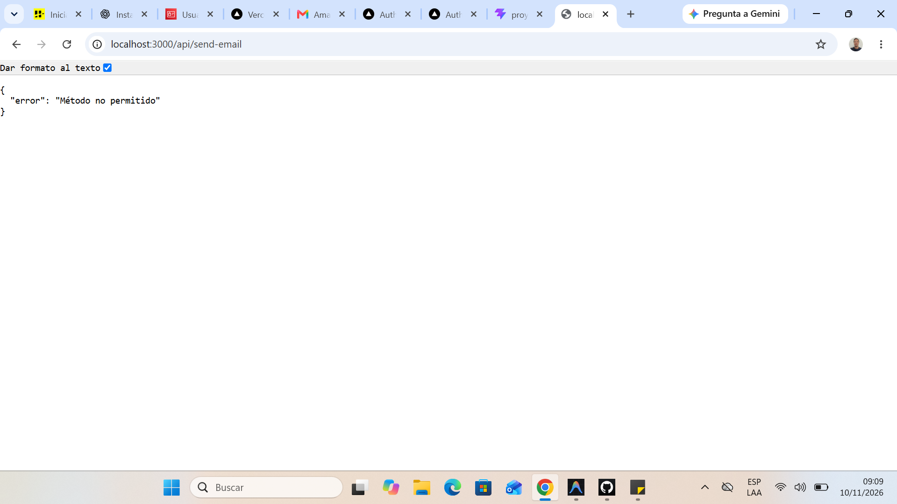
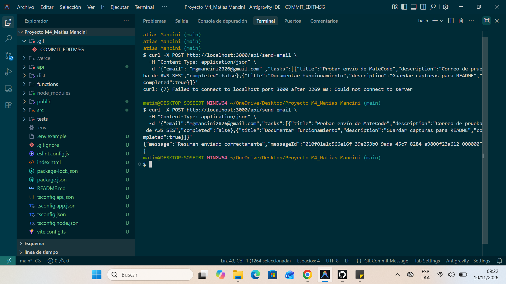
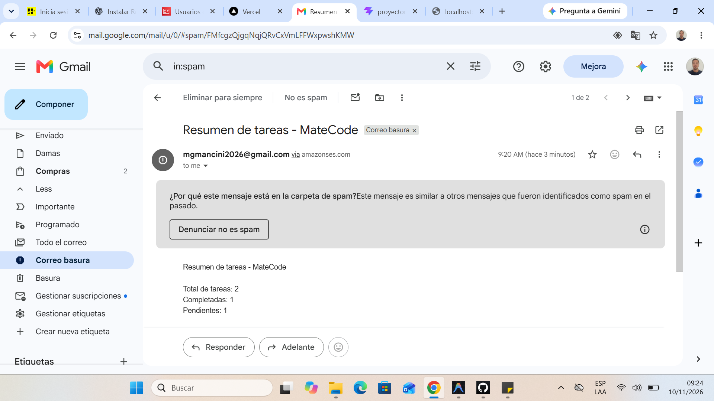
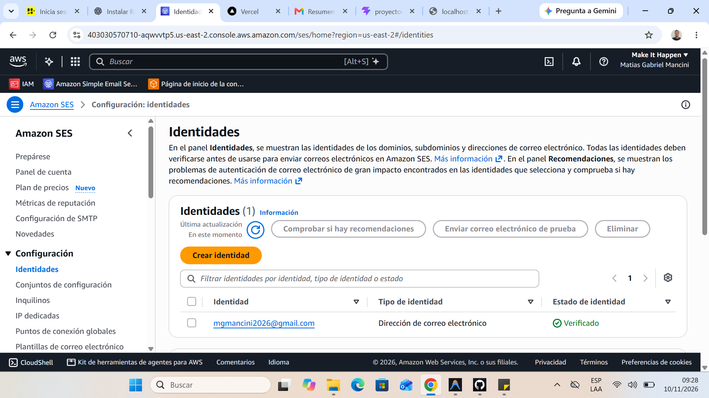
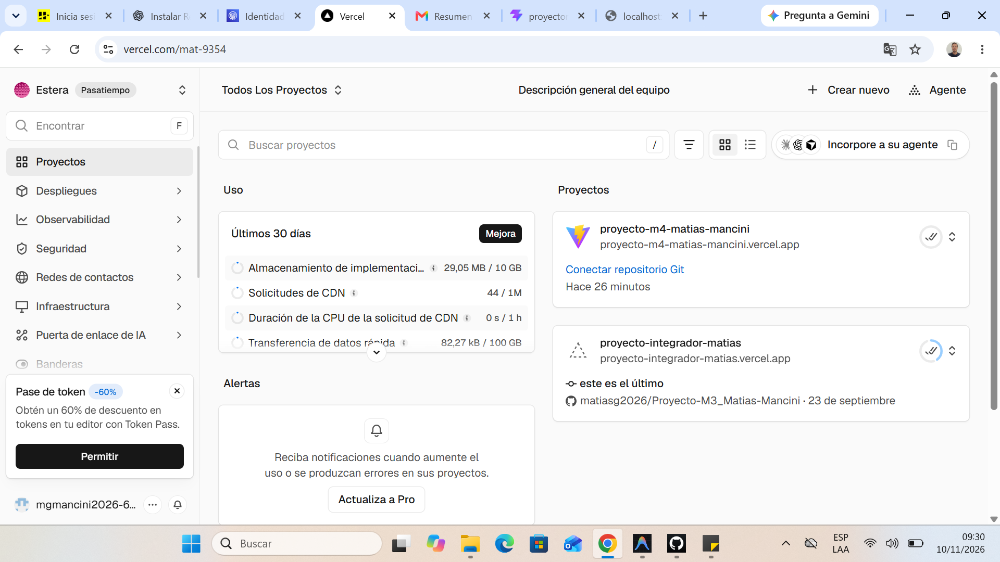
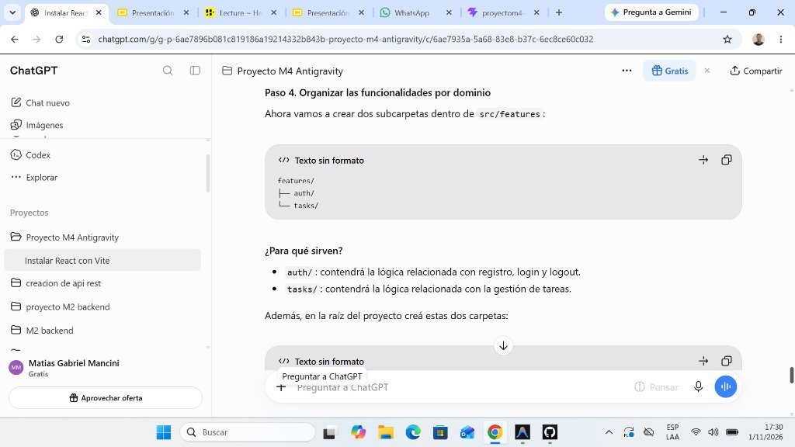
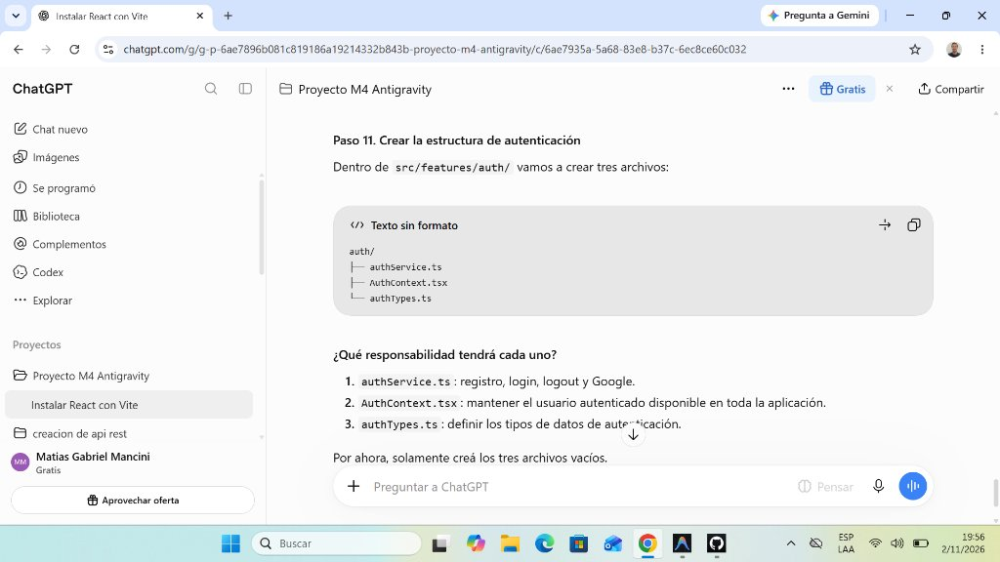
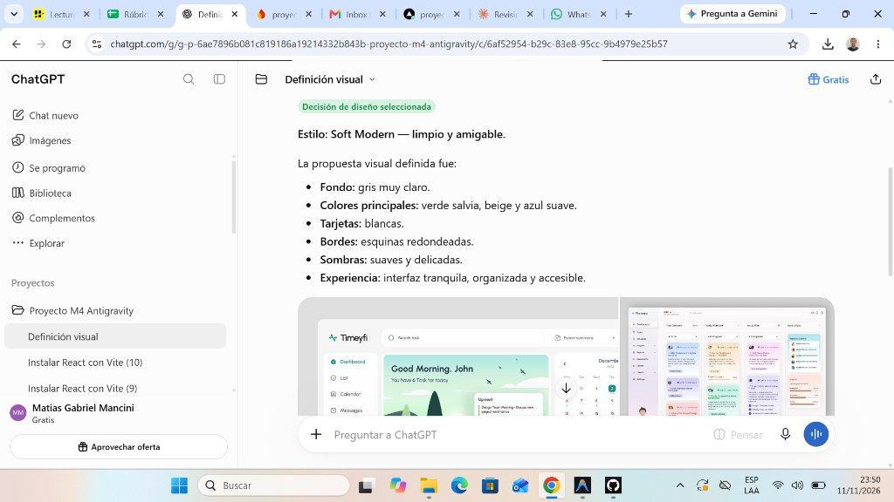

# 🧉 MateCode — Aplicación de Gestión de Tareas

> **Proyecto Integrador M4 · Henry**  
> Aplicación web moderna, robusta y segura para la administración de tareas diarias, desarrollada con **React 19**, **TypeScript** y arquitectura serverless con **Firebase** y **AWS SES**.

---

## 🔗 Enlaces del Proyecto

| Recurso | Enlace |
| :--- | :--- |
| 🌐 **Producción (Vercel)** | [proyecto-m4-matias-mancini.vercel.app](https://proyecto-m4-matias-mancini.vercel.app/) |
| 💻 **Repositorio (GitHub)** | [github.com/matiasg2026/Proyecto-M4_Matias-Mancini](https://github.com/matiasg2026/Proyecto-M4_Matias-Mancini) |
| 🛠️ **Entorno Local (Vite)** | `http://localhost:5173` |
| ⚡ **Entorno Local Serverless (Vercel)** | `http://localhost:3000` |

---

## 📑 Tabla de Contenidos

1. [Descripción General](#-descripción-general)
2. [Demostración en Video](#-demostración-en-video)
3. [Funcionalidades](#-funcionalidades)
4. [Tecnologías Utilizadas](#-tecnologías-utilizadas)
5. [Arquitectura y Organización](#-arquitectura-y-organización)
6. [Instalación y Ejecución Local](#️-instalación-y-ejecución-local)
7. [Autenticación y Rutas Protegidas](#-autenticación-y-rutas-protegidas)
8. [Persistencia con Firestore y Seguridad](#-persistencia-con-firestore-y-seguridad)
9. [Función Serverless y AWS SES](#-función-serverless-y-aws-ses)
10. [Testing y Control de Calidad](#-testing-y-control-de-calidad)
11. [Despliegue en Producción](#-despliegue-en-producción)
12. [Optimización de Rendimiento y Code Splitting](#-optimización-de-rendimiento-y-code-splitting)
13. [Evidencias de Funcionamiento](#-evidencias-de-funcionamiento)
14. [Uso Crítico y Responsable de IA](#-uso-crítico-y-responsable-de-ia)
15. [Convención de Commits](#-convención-de-commits)
16. [Diseño](#-diseño)
17. [Autor](#-autor)

---

## 📌 Descripción General

**MateCode** es una solución integral diseñada para que los usuarios gestionen sus actividades diarias de forma ágil, organizada e intuitiva. Integra autenticación de usuarios por múltiples proveedores, persistencia en tiempo real en la nube garantizando la privacidad de los datos por usuario, y un servicio automatizado para el envío de resúmenes por correo electrónico a través de la infraestructura cloud de Amazon Web Services (AWS SES).

---

## 🎬 Demostración en Video

A continuación se presenta el recorrido audiovisual completo de la aplicación, mostrando el flujo de registro, inicio de sesión, creación, edición, alternancia de estados y eliminación de tareas en tiempo real, junto con el despacho del resumen por correo:

> [!TIP]
> 📺 **[Haz clic aquí para reproducir el video en el visor de GitHub (demo.mp4)](./src/assets/demo.mp4)**  
> *(Al hacer clic en el enlace, GitHub abrirá su reproductor de video nativo con controles de pausa, volumen y pantalla completa).*

<p align="center">
  <video src="./src/assets/demo.mp4" controls width="100%" poster="./src/assets/05-vercel-proyecto.png">
    Tu navegador o entorno no soporta la previsualización directa. <a href="./src/assets/demo.mp4">Haz clic aquí para reproducir o descargar demo.mp4 en GitHub.</a>
  </video>
</p>

---

## ✨ Funcionalidades

- **Autenticación completa:**
  - Registro e inicio de sesión seguro con correo electrónico y contraseña.
  - Inicio de sesión rápido con cuenta de Google (OAuth).
  - Cierre de sesión y persistencia automática del estado del usuario al recargar la aplicación.
- **Seguridad en la navegación:**
  - Rutas protegidas (`ProtectedRoute`): redirección automática de usuarios no autenticados al login.
- **Gestión integral de tareas (CRUD):**
  - Creación de tareas con título y descripción detallada.
  - Listado de tareas con actualización reactiva en tiempo real.
  - Edición en línea de información de tareas existentes.
  - Eliminación individual de tareas con confirmación visual.
  - Marcado ágil de estado: alternancia entre **completada** y **pendiente**.
- **Aislamiento de datos:**
  - Cada usuario accede y gestiona única y exclusivamente sus propias tareas mediante filtrado por `userId` y reglas de seguridad en la base de datos.
- **Resumen por correo electrónico:**
  - Envío bajo demanda de un reporte detallado con métricas (total, pendientes, completadas y detalle de tareas) vía **AWS SES**.
- **Experiencia de usuario (UX):**
  - Notificaciones de error y éxito contextuales, spinners de carga y estados vacíos amigables cuando no hay tareas.

---

## 🚀 Tecnologías Utilizadas

| Tecnología | Rol en el Proyecto |
| :--- | :--- |
| **React 19** | Biblioteca principal para la construcción de interfaces modulares y reactivas (SPA). |
| **TypeScript** | Tipado estático riguroso para props, estados, eventos, modelos y servicios. |
| **Vite** | Herramienta de compilación ultra-rápida y entorno de desarrollo moderno. |
| **React Router DOM 7** | Enrutamiento del cliente, navegación declarativa y protección de vistas. |
| **Firebase Auth** | Gestión integral del ciclo de vida de usuarios, tokens y proveedores de identidad. |
| **Cloud Firestore** | Base de datos NoSQL documental en la nube con soporte de sincronización reactiva (`onSnapshot`). |
| **AWS SDK (SES v3)** | Integración con Amazon Simple Email Service para el despacho de correos transaccionales. |
| **Vercel Functions** | Entorno serverless backend para proteger credenciales privadas de AWS. |
| **Vitest** | Test runner de alto rendimiento nativo para entornos basados en Vite. |
| **React Testing Library** | Pruebas de integración centradas en el comportamiento del usuario y el DOM. |
| **ESLint** | Aseguramiento de estándares de código, buenas prácticas y consistencia sintáctica. |

---

## 🏗️ Arquitectura y Organización

El proyecto implementa una arquitectura por capas desacopladas, asegurando modularidad, facilidad de mantenimiento y alta capacidad de testeo:

```text
Proyecto-M4_Matias-Mancini/
├── api/
│   └── send-email.ts          # Endpoint serverless (Vercel) para envío de correos con AWS SES
├── src/
│   ├── assets/                # Recursos estáticos, capturas de evidencias y video demo (demo.mp4)
│   ├── features/
│   │   ├── auth/              # Contexto de autenticación, servicios y tipos (AuthContext, authService, authTypes)
│   │   └── tasks/             # Lógica de negocio y acceso a datos de tareas (taskService)
│   ├── pages/                 # Vistas principales de la app (Login, Register, Tasks)
│   ├── routes/                # Componentes de enrutamiento y guardias (ProtectedRoute)
│   ├── services/              # Inicialización y configuración central de Firebase
│   ├── types/                 # Definición de modelos e interfaces TypeScript compartidas (task.ts)
│   ├── App.css                # Estilos base de la aplicación
│   ├── App.tsx                # Definición de rutas y jerarquía de componentes
│   ├── index.css              # Estilos globales y paleta de diseño Soft Modern
│   └── main.tsx               # Punto de entrada del cliente React
├── tests/                     # Suite completa de pruebas unitarias y de integración
│   ├── setup.ts               # Inicialización global de pruebas y matchers de testing-library
│   ├── setup.test.ts          # Verificación de sanidad del entorno de test
│   ├── AuthContext.test.tsx   # Pruebas del contexto y ciclo de vida de la autenticación
│   ├── Tasks.test.tsx         # Pruebas funcionales y de renderizado del módulo de tareas
│   └── taskService.test.ts    # Pruebas unitarias sobre las operaciones CRUD de Firestore
├── .env.example               # Plantilla de variables de entorno requeridas
├── eslint.config.js           # Reglas de análisis estático
├── index.html                 # Documento HTML raíz
├── package.json               # Configuración de dependencias y scripts de ejecución
├── tsconfig.json              # Configuración base de TypeScript
├── tsconfig.app.json          # Reglas del compilador para la aplicación
├── tsconfig.node.json         # Reglas del compilador para herramientas de compilación
└── vite.config.ts             # Configuración de empaquetado y entorno de testing
```

### Responsabilidad de cada capa

| Capa | Responsabilidad |
| :--- | :--- |
| **`pages/`** | Orquestación visual de pantallas, conexión de estados locales y gestión de interacción. |
| **`features/auth/`** | Gestión del estado global de autenticación (`useAuth`), inicio/cierre de sesión y tipos asociados. |
| **`features/tasks/`** | Servicios especializados de base de datos (`taskService.ts`), mapeo de documentos y suscripciones en tiempo real. |
| **`routes/`** | Control de acceso perimetral verificando el estado de autenticación antes de renderizar vistas privadas. |
| **`services/`** | Inicialización centralizada de instancias de Firebase (`auth`, `db`) a partir de variables de entorno. |
| **`api/`** | Backend serverless aislado para procesar peticiones seguras a AWS sin exponer credenciales al cliente. |

### Flujo de datos

```text
[ Usuario ] ◄──► [ Componente (UI) ] ──► [ taskService ] ──► [ Cloud Firestore ]
                         │                                           ▲
                         │                                           │ (onSnapshot)
                         ▼                                           │
             [ Estado React (useState) ] ◄───────────────────────────┘

[ Solicitud de Resumen ] ──► [ POST /api/send-email ] ──► [ AWS SES SDK ] ──► [ Bandeja de Correo ]
```

---

## ⚙️ Instalación y Ejecución Local

### Requisitos previos
- **Node.js** 18.0.0 o superior
- **npm** 9.0.0 o superior
- Proyecto configurado en **Firebase Console** (con Authentication y Cloud Firestore habilitados)
- Cuenta de **AWS** con el servicio **SES** configurado e identidades verificadas

### 1. Clonar el repositorio
```bash
git clone https://github.com/matiasg2026/Proyecto-M4_Matias-Mancini.git
cd Proyecto-M4_Matias-Mancini
```

### 2. Instalar dependencias
```bash
npm install
```

### 3. Configuración de variables de entorno
Crea un archivo `.env` en la raíz del proyecto tomando como plantilla `.env.example`:

```env
# Configuración pública de Firebase (Frontend)
VITE_FIREBASE_API_KEY=tu_api_key
VITE_FIREBASE_AUTH_DOMAIN=tu_proyecto.firebaseapp.com
VITE_FIREBASE_PROJECT_ID=tu_proyecto_id
VITE_FIREBASE_STORAGE_BUCKET=tu_proyecto.firebasestorage.app
VITE_FIREBASE_MESSAGING_SENDER_ID=tu_sender_id
VITE_FIREBASE_APP_ID=tu_app_id

# Configuración privada de AWS SES (Solo Backend Serverless)
AWS_ACCESS_KEY_ID=tu_aws_access_key
AWS_SECRET_ACCESS_KEY=tu_aws_secret_key
AWS_REGION=us-east-2
SES_FROM_EMAIL=remitente_verificado@tudominio.com
SES_TO_EMAIL=destinatario_verificado@tudominio.com
```

> [!WARNING]
> Las credenciales de AWS son estrictamente confidenciales. **Nunca deben llevar el prefijo `VITE_`** ni ser subidas al repositorio. El archivo `.env` se encuentra ignorado en `.gitignore`.

### 4. Ejecución del proyecto

- **Solo frontend (desarrollo Vite):**
  ```bash
  npm run dev
  ```
  *Disponible en:* `http://localhost:5173`

- **Frontend + Funciones Serverless (emulación completa de Vercel para probar envío de emails):**
  ```bash
  npx vercel dev
  ```
  *Disponible en:* `http://localhost:3000`

### Scripts disponibles en `package.json`

| Comando | Descripción |
| :--- | :--- |
| `npm run dev` | Inicia el servidor de desarrollo local con Vite (puerto por defecto 5173). |
| `npm run build` | Compila los tipos de TypeScript (`tsc -b`) y genera el bundle optimizado para producción. |
| `npm run test` | Ejecuta la suite de pruebas en modo interactivo con Vitest. |
| `npm run test:run` | Ejecuta una única pasada de todos los tests y reporta el resultado en consola. |
| `npm run lint` | Analiza el código fuente en busca de errores estilísticos o sintácticos con ESLint. |
| `npm run preview` | Previsualiza localmente el resultado de la carpeta `dist` compilada. |

---

## 🔐 Autenticación y Rutas Protegidas

El sistema de autenticación se gestiona a través de [AuthContext.tsx](file:///c:/Users/matim/OneDrive/Desktop/Proyecto%20M4_Matias%20Mancini/src/features/auth/AuthContext.tsx) y [authService.ts](file:///c:/Users/matim/OneDrive/Desktop/Proyecto%20M4_Matias%20Mancini/src/features/auth/authService.ts):

- **Proveedores soportados:**
  - Correo electrónico y contraseña (`createUserWithEmailAndPassword`, `signInWithEmailAndPassword`).
  - Google Provider vía ventana emergente (`signInWithPopup`, `GoogleAuthProvider`).
- **Persistencia de sesión:** Se implementa un listener `onAuthStateChanged` que garantiza que el usuario permanezca autenticado tras recargas de página, ofreciendo una pantalla de carga mientras el estado se resuelve.
- **Guardias de navegación (`ProtectedRoute`):** Evalúa el estado `user` y `loading`. Si un usuario intenta acceder a `/tasks` sin sesión activa, es redirigido automáticamente a `/login` preservando la integridad de las rutas.
- **Traducción y manejo de errores:** Mensajes amigables para códigos comunes de Firebase como `auth/user-not-found`, `auth/wrong-password`, `auth/email-already-in-use` y `auth/weak-password`.

---

## 🗄️ Persistencia con Firestore y Seguridad

Las tareas se almacenan en la colección `tasks` de Cloud Firestore. Cada documento respeta la siguiente estructura definida en [task.ts](file:///c:/Users/matim/OneDrive/Desktop/Proyecto%20M4_Matias%20Mancini/src/types/task.ts):

```typescript
export interface Task {
  id: string;
  userId: string;
  title: string;
  description: string;
  completed: boolean;
  createdAt: Date;
  updatedAt: Date;
}
```

### Sincronización en tiempo real
A través de `subscribeToTasks` en [taskService.ts](file:///c:/Users/matim/OneDrive/Desktop/Proyecto%20M4_Matias%20Mancini/src/features/tasks/taskService.ts), la aplicación utiliza `onSnapshot` con una query filtrada por `where("userId", "==", userId)`. Esto asegura que cualquier creación, actualización o eliminación se refleje de manera instantánea en la interfaz sin necesidad de refrescar la página manualmente.

### Reglas de Seguridad en Cloud Firestore

Para garantizar que los datos estén completamente aislados y un usuario no pueda acceder a las tareas de otro, se configuran las siguientes reglas de seguridad en Firebase:

```javascript
rules_version = '2';
service cloud.firestore {
  match /databases/{database}/documents {
    match /tasks/{taskId} {
      // Solo el propietario puede leer, modificar o eliminar sus tareas
      allow read, update, delete: if request.auth != null && resource.data.userId == request.auth.uid;
      
      // Solo usuarios autenticados pueden crear tareas asignadas a su propio UID
      allow create: if request.auth != null && request.resource.data.userId == request.auth.uid;
    }
  }
}
```

---

## 📧 Función Serverless y AWS SES

Para evitar que las credenciales maestras de AWS (`AWS_ACCESS_KEY_ID` y `AWS_SECRET_ACCESS_KEY`) se expongan en el código del cliente, la comunicación con **Amazon SES** se encapsula dentro de la función serverless [api/send-email.ts](file:///c:/Users/matim/OneDrive/Desktop/Proyecto%20M4_Matias%20Mancini/api/send-email.ts).

### Especificación del Endpoint

- **Ruta:** `POST /api/send-email`
- **Headers requeridos:** `Content-Type: application/json`

#### Estructura del Payload (Request)
```json
{
  "email": "usuario@ejemplo.com",
  "tasks": [
    {
      "title": "Estudiar React",
      "description": "Repasar hooks y ciclo de vida",
      "completed": true
    },
    {
      "title": "Integrar AWS SES",
      "description": "Configurar credenciales y función serverless",
      "completed": false
    }
  ]
}
```

#### Códigos de Respuesta HTTP

| Código | Significado | Descripción |
| :---: | :--- | :--- |
| `200` | **OK** | El correo con el resumen formateado fue despachado exitosamente por AWS SES. |
| `400` | **Bad Request** | Fallo en la validación del body (email inválido, formato de tareas incorrecto o lista mayor a 100 elementos). |
| `405` | **Method Not Allowed** | Se intentó acceder con un método HTTP distinto a `POST`. |
| `500` | **Internal Server Error** | Error interno o credenciales de entorno faltantes/rechazadas en AWS SES. |

> [!NOTE]
> Durante la etapa de pruebas y desarrollo, la cuenta de AWS SES operó bajo el entorno **Sandbox**, motivo por el cual tanto el correo remitente (`SES_FROM_EMAIL`) como el destinatario (`SES_TO_EMAIL`) debieron ser identidades previamente verificadas dentro de la consola de AWS.

---

## 🧪 Testing y Control de Calidad

El proyecto cuenta con una cobertura integral de pruebas unitarias y de integración implementadas con **Vitest** y **React Testing Library**:

```bash
npm run test:run
```

### Resultados de la Suite de Pruebas

```text
✓ tests/setup.test.ts (1 test)
✓ tests/taskService.test.ts (5 tests)
✓ tests/AuthContext.test.tsx (3 tests)
✓ tests/Tasks.test.tsx (11 tests)

Test Files  4 passed (4)
Tests       20 passed (20)
```

### Alcance de las Pruebas

1. **`setup.test.ts`:** Verificación del entorno de pruebas bajo `jsdom`.
2. **`taskService.test.ts`:** Cobertura de la lógica de negocio CRUD contra Firestore mediante mocks aislados (`createTask`, `getTasks`, `updateTask`, `toggleTaskCompleted`, `deleteTask`).
3. **`AuthContext.test.tsx`:** Verificación del estado inicial de carga, actualización del usuario tras respuesta de Firebase y tratamiento de sesión nula.
4. **`Tasks.test.tsx`:**
   - Renderizado del correo del usuario activo.
   - Mensaje de bienvenida ante lista vacía.
   - Listado correcto de tareas cargadas.
   - Validación de campos requeridos (prevención de creación con título vacío).
   - Acciones de completar, editar y eliminar tareas.
   - Manejo y presentación en pantalla de alertas de error en caso de fallo de red en Firebase.

---

## 🌐 Despliegue en Producción

- **Plataforma:** [Vercel](https://vercel.com/)
- **URL activa:** [https://proyecto-m4-matias-mancini.vercel.app](https://proyecto-m4-matias-mancini.vercel.app/)
- **Estrategia de despliegue:**
  - Integración continua vinculada a la rama principal de GitHub.
  - Variables de entorno de Firebase y AWS inyectadas de forma segura desde el panel de control de Vercel (**Settings → Environment Variables**).
  - Las credenciales privadas nunca quedan embebidas en el repositorio público.

---

## ⚡ Optimización de Rendimiento y Code Splitting

Durante el proceso de compilación para producción (`npm run build`), el empaquetador Vite originalmente arrojaba una advertencia de rendimiento:
`(!) Some chunks are larger than 500 kB after minification`, ocasionada porque se agrupaban todas las dependencias externas (React, React Router y los módulos de Firebase Authentication y Cloud Firestore) en un único archivo monolítico de **831.18 kB** (`index.js`).

### Solución Implementada: Code Splitting con `manualChunks`

Sin alterar el funcionamiento de la aplicación ni modificar estilos visuales, se configuró una estrategia avanzada de división de paquetes en [vite.config.ts](file:///c:/Users/matim/OneDrive/Desktop/Proyecto%20M4_Matias%20Mancini/vite.config.ts) mediante `build.rollupOptions.output.manualChunks`:

- **`firebase-firestore`:** Aísla el motor de base de datos NoSQL y los listeners de sincronización en tiempo real (~413 kB).
- **`react-vendor`:** Agrupa el núcleo de React 19, React DOM y React Router DOM (~256 kB).
- **`firebase-auth`:** Separa la lógica de autenticación y gestión de sesiones (~106 kB).
- **`firebase-core`:** Aloja la inicialización base de la app de Firebase (~49 kB).
- **Carga bajo demanda (`React.lazy` + `Suspense`):** Las páginas (`Login`, `Register`, `Tasks`) se descargan de forma perezosa en fragmentos independientes menores a 8 kB cada uno.

### Comparativa de Métricas de Compilación

| Fragmento / Chunk | Tamaño Antes | Tamaño Optimizado | Gzip | Estado |
| :--- | :---: | :---: | :---: | :---: |
| **`index.js` (unificado)** | 831.18 kB | *Dividido* | — | ⚠️ Advertencia > 500 kB |
| **`firebase-firestore.js`** | — | **413.20 kB** | 120.94 kB | ✅ Óptimo (< 500 kB) |
| **`react-vendor.js`** | — | **256.97 kB** | 81.48 kB | ✅ Óptimo (< 500 kB) |
| **`firebase-auth.js`** | — | **106.23 kB** | 31.95 kB | ✅ Óptimo (< 500 kB) |
| **`firebase-core.js`** | — | **49.12 kB** | 18.39 kB | ✅ Óptimo (< 500 kB) |
| **Vistas (`Tasks`, `Login`, etc.)** | — | **< 8 kB c/u** | < 2.5 kB c/u | ✅ Carga bajo demanda |

**Beneficios obtenidos:**
- **Eliminación total de alertas en consola:** Cero chunks por encima del límite de 500 kB.
- **Descargas paralelas y caché eficiente:** El navegador puede almacenar en caché las librerías independientes y no invalidar todo el bundle ante cambios menores de código.
- **Menor tiempo de carga inicial:** Se acelera notablemente la métrica *Time to Interactive* (TTI) para el usuario final.

---

## 📸 Evidencias de Funcionamiento

### 1. Endpoint de la API Serverless
Prueba de funcionamiento y respuesta de la función `/api/send-email` ejecutándose en el entorno serverless:


### 2. Envío Exitoso mediante AWS SES
Confirmación del despacho del correo con el resumen de tareas desde la aplicación:


### 3. Recepción del Correo Electrónico
Comprobación de entrega del mensaje en la bandeja de entrada con el formato y detalle de actividades:

.png)

### 4. Identidad Verificada en AWS SES
Panel de configuración en Amazon Web Services validando el correo emisor/receptor en estado verificado:


### 5. Proyecto Desplegado en Vercel
Panel de control de Vercel confirmando el despliegue exitoso en producción:


---

## 🤖 Uso Crítico y Responsable de IA

Durante el desarrollo de la aplicación se utilizaron herramientas de Inteligencia Artificial (asistentes de código basados en modelos LLM) como soporte técnico para acelerar el aprendizaje y contrastar decisiones arquitectónicas.

### Patrón de uso aplicado
- **Consultas conceptuales y de arquitectura:** Se solicitó asistencia para estructurar la separación de capas y entender las mejores prácticas para comunicar el frontend con funciones serverless sin comprometer secretos.
- **Depuración de tipado:** Asistencia para resolver la compatibilidad entre los matchers de `@testing-library/jest-dom` y Vitest, así como los tipos de `NextOrObserver` en los mocks de Firebase Authentication.
- **Validación contra documentación oficial:** Ninguna sugerencia de código fue incorporada a ciegas; cada snippet fue contrastado con las guías oficiales de Firebase v11, AWS SDK v3 y React 19.

### Decisiones técnicas justificadas
| Decisión Técnica | Justificación Profesional |
| :--- | :--- |
| **Serverless para AWS SES** | Impide terminantemente exponer las claves `AWS_ACCESS_KEY_ID` y `AWS_SECRET_ACCESS_KEY` en el bundle del navegador. |
| **Suscripción con `onSnapshot`** | Garantiza reactividad en tiempo real sin obligar al usuario a recargar la página tras cada acción. |
| **Aislamiento por `userId` + Reglas** | Aplica el principio de defensa en profundidad: los datos se filtran en la consulta del cliente y se validan en el servidor de Firestore. |
| **Code Splitting con `manualChunks`** | Desacopla bundles pesados (> 500 kB), optimiza la carga inicial en red y la caché del navegador sin alterar estilos ni funcionalidades. |
| **Mocks en Vitest** | Asegura que la suite de tests unitarios sea rápida, predecible y capaz de correr en entornos de integración continua sin conexión a internet. |

### Evidencias de interacción y planificación con IA

Se documentan a continuación ejemplos del proceso de consulta guiada por pasos con ChatGPT para la arquitectura y el diseño visual:

#### 1. Planificación de la arquitectura modular por dominio (`features/`)
Estructuración de carpetas en `src/features/` (`auth/` y `tasks/`) para delimitar las responsabilidades de cada módulo:


#### 2. Definición de responsabilidades en el módulo de autenticación
Estructuración y delimitación de roles entre `authService.ts`, `AuthContext.tsx` y `authTypes.ts`:


#### 3. Especificación del sistema de diseño visual (Estilo Soft Modern)
Definición de la propuesta estética (paleta de tonos verde salvia, beige y azul suave sobre fondo gris claro, tarjetas blancas redondeadas y sombras sutiles):


---

## 📝 Convención de Commits

El proyecto implementa el estándar [Conventional Commits](https://www.conventionalcommits.org/es/) para mantener un historial de versiones limpio, descriptivo y trazable:

| Prefijo | Propósito | Ejemplo |
| :---: | :--- | :--- |
| `feat:` | Incorporación de una nueva funcionalidad | `feat: agregar envio de resumen de tareas con AWS SES` |
| `fix:` | Corrección de un fallo o error detectado | `fix: resolver aserciones de tipos en AuthContext.test` |
| `docs:` | Actualizaciones en documentación o README | `docs: estructurar seccion de arquitectura y variables` |
| `test:` | Creación o refactorización de pruebas unitarias | `test: agregar casos de prueba para el CRUD de tareas` |
| `refactor:` | Modificaciones de código sin alterar su comportamiento | `refactor: desacoplar servicios de Firestore en taskService` |
| `chore:` | Ajustes en dependencias o configuración del build | `chore: actualizar overrides de paquetes para corregir vulnerabilidades` |

---

## 🎨 Diseño

La aplicación se diseñó bajo el concepto **Soft Modern**, priorizando la legibilidad, la calma visual y la facilidad de uso:

- **Paleta cromática:** Tonos verde salvia, beige cálido y acentos en azul suave sobre un fondo gris claro descansado.
- **Componentes:** Tarjetas blancas elevadas con bordes redondeados (`rounded-xl`), tipografía legible y sombras sutiles.
- **Diseño Responsivo:** Adaptación fluida tanto para pantallas de escritorio como para dispositivos móviles y tablets.

---

## 👨‍💻 Autor

**Matías Mancini**  
*Proyecto Integrador M4 — Henry*  
- GitHub: [@matiasg2026](https://github.com/matiasg2026)  
- Proyecto: [MateCode Task Manager](https://proyecto-m4-matias-mancini.vercel.app/)